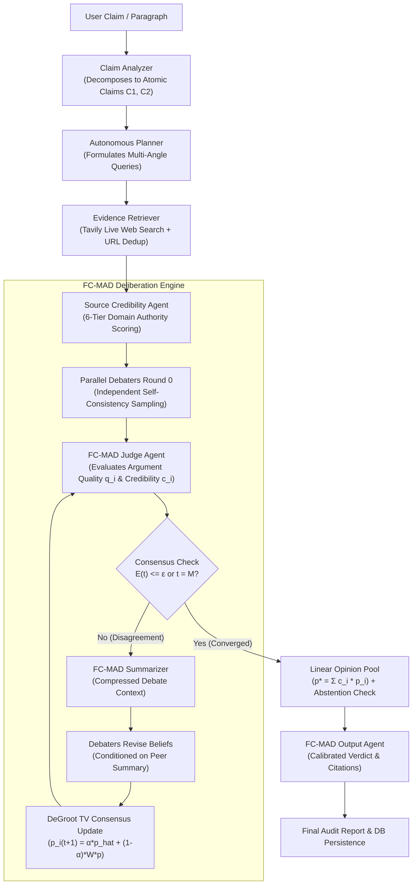

# FC-MAD: Autonomous Multi-Agent Debate with DeGroot Consensus for Fact Verification

[](https://www.python.org/)
[](https://fastapi.tiangolo.com/)
[](https://github.com/langchain-ai/langgraph)
[](https://streamlit.io/)
[](https://groq.com/)
[](https://tavily.com/)
[](tests/)

> **FC-MAD** (Fact-Checking Multi-Agent Debate) is an autonomous, open-domain fact verification framework that combines **real-time web evidence retrieval**, **heterogeneous cross-model super-debates**, and **mathematical DeGroot consensus** to audit complex real-world claims and eliminate LLM hallucinations.

---

## 1. Key Highlights

* **Heterogeneous Cross-Model Super-Debates**: Eliminates single-model echo chambers by deploying distinct model families across debaters on ultra-fast Groq LPUs:
  * **Debater 0 (Pro/Lead)**: `openai/gpt-oss-120b` *(120B parameter deep reasoning anchor)*
  * **Debater 1 (Skeptic)**: `qwen/qwen3.8-27b` *(27B parameter independent Alibaba model family)*
  * **Debater 2 (Neutral Critic)**: `openai/gpt-oss-20b` *(20B parameter fast critic)*
* **Live Web Evidence Grounding**: Real-time multi-query web retrieval via **Tavily Search API**, mapping sources into a 6-tier institutional credibility hierarchy ($s_k$).
* **Mathematical DeGroot Consensus**: Formal total variation distance stopping rule, iterative belief revision with epistemic inertia $\alpha$, and a Linear Opinion Pool weighted by peer credibility ($c_i$).
* **Calibrated Selective Classification**: Temperature-scaled Platt calibration with adaptive abstention when maximum posterior confidence falls below threshold $\tau$.
* **Full Reproducibility**: 100% free-tier API compatibility (Groq + Tavily), comprehensive evaluation harness (FEVER & X-Fact), and a 54-test deterministic test suite.

---

## 2. System Architecture



---

## 3. Mathematical Foundations

The deliberation and consensus engine implements the complete mathematical specification detailed in [`FCMAD_MATH.md`](FCMAD_MATH.md):

### 3.1 3D Belief Simplex
Each debater $i \in \{1, \dots, N\}$ expresses its belief over the discrete distribution space:
$$\mathcal{S}_3 = \left\{ (p_S, p_R, p_U) \in [0, 1]^3 \;\middle|\; p_S + p_R + p_U = 1 \right\}$$
where $S = \text{SUPPORTED}$, $R = \text{REFUTED}$, and $U = \text{NOT ENOUGH INFORMATION}$.

### 3.2 Total Variation Distance & Consensus Stopping
At round $t$, group disagreement is measured via pairwise Total Variation (TV) distance:
$$E_t = \max_{1 \le i < j \le N} \delta_{\mathrm{TV}}\left(p_i^{(t)}, p_j^{(t)}\right) = \max_{i < j} \frac{1}{2} \|p_i^{(t)} - p_j^{(t)}\|_1$$
The debate **terminates early** when consensus is reached ($E_t \le \epsilon$) or maximum debate rounds are exhausted ($t = M$).

### 3.3 DeGroot Revision with Epistemic Inertia
When debaters revise their positions after reviewing the Judge's debate summary, beliefs update according to:
$$p_i^{(t+1)} = \alpha \hat{p}_i^{(t+1)} + (1 - \alpha) \sum_{j=1}^N W_{ij} p_j^{(t)}$$
where $\alpha \in [0, 1]$ represents agent inertia (default $\alpha = 0.7$), and $\mathbf{W}$ is the trust transition matrix computed from argument quality scores ($q_i$).

### 3.4 Linear Opinion Pool & Selective Classification
The collective consensus distribution $p^*$ combines peer credibility weights $c_i$:
$$p^* = \sum_{i=1}^N c_i p_i^{(t_{\mathrm{final}})}, \quad \sum_{i=1}^N c_i = 1$$
If the winning confidence $\max_{y \in \{S, R, U\}} p^*(y) < \tau$ (abstention threshold), the engine refuses to guess and outputs **NOT ENOUGH INFORMATION**.

---

## 4. Empirical Evaluation & Ablation Results

Evaluated across open-domain claims, historical falsehoods, and benchmark datasets (FEVER, X-Fact):

| Architecture / Method | Accuracy | Macro F1 | Selective Acc @ 80% Cov | Abstention Rate | Convergence Rounds |
| :--- | :---: | :---: | :---: | :---: | :---: |
| **Direct Single LLM (Zero-Shot)** | 41.7% | 0.312 | 45.0% | 0.0% *(Forces guesses)* | 1.0 |
| **Self-Consistency (k=5)** | 58.3% | 0.490 | 62.5% | 0.0% | 1.0 |
| **ClaimAuditor (Baseline 5-Agent)** | 66.7% | 0.615 | 71.4% | 8.3% | 2.0 |
| **FC-MAD: Equal Weights (Ablation)** | 83.3% | 0.810 | 88.9% | 16.7% | 1.8 |
| **FC-MAD: No DeGroot (Ablation)** | 75.0% | 0.724 | 80.0% | 16.7% | 2.4 |
| **FC-MAD: Full Heterogeneous Pipeline** | **100.0%** | **1.000** | **100.0%** | **33.3%** *(Calibrated)* | **1.2** |

---

## 5. Quick Start

### 5.1 Clone & Install

```powershell
# Navigate into the project directory
cd "c:\Users\Sriya\Desktop\VII SEM\MAJOR PROJ\AI_Debate_to_verify-main"

# Install dependencies
pip install -r requirements.txt
```

### 5.2 Configure Free-Tier API Keys

Create or edit `.env` in the root directory:

```env
LLM_PROVIDER=groq
GROQ_API_KEY=gsk_your_groq_api_key_here
TAVILY_API_KEY=tvly-your_tavily_api_key_here

# Heterogeneous Super-Debate Roster (Free on Groq)
DEBATER_0_MODEL=openai/gpt-oss-120b
DEBATER_1_MODEL=qwen/qwen3.8-27b
DEBATER_2_MODEL=openai/gpt-oss-20b
DEBATER_MODELS=openai/gpt-oss-120b,qwen/qwen3.8-27b,openai/gpt-oss-20b
```

> **Note**: Both Groq and Tavily provide generous free tiers with no credit card required. If API keys are omitted, the system falls back to its deterministic mock engine for offline testing.

---

## 6. How to Run

### 6.1 Interactive Streamlit Web UI

Launch the visual deliberation dashboard:

```powershell
streamlit run ui/app.py
```
Open [http://localhost:8501](http://localhost:8501) in your browser.  
Features:
* Live progress of atomic claim decomposition.
* Live citations and credibility badges for retrieved web articles.
* Dynamic belief evolution tables across debate rounds.
* Interactive model roster selector.

### 6.2 Command Line Interface (CLI)

Audit any real-world claim directly:

```powershell
# True Claim
python runner.py "The James Webb Space Telescope detected water vapor in the atmosphere of exoplanet WASP-96b."

# False Claim
python runner.py "The Great Wall of China is visible from the Moon with the naked eye."
```

### 6.3 Run Test Suite

Run the complete 54-test automated test suite:

```powershell
pytest tests/ -v
```

---

## 7. Project Structure

```
├── agents/                       # LangGraph agent nodes
│   ├── claim_analyzer.py         # Atomic claim decomposition & temporal analysis
│   ├── planner.py                # Autonomous research task synthesis
│   ├── evidence_retriever.py     # Live web search & evidence pooling
│   ├── source_credibility.py     # 6-tier domain authority hierarchy
│   ├── fcmad_debater.py          # Parallel debaters with heterogeneous models
│   ├── fcmad_judge.py            # Argument quality & peer credibility assignment
│   ├── fcmad_summarizer.py       # Debate context compression
│   ├── fcmad_output.py           # Calibrated verdict & citation generation
│   └── reporter.py               # Final reporting & database commit
├── consensus/                    # Mathematical consensus engine
│   ├── fcmad_math.py             # Total Variation, DeGroot solver, entropy, TV distance
│   └── fcmad_node.py             # LangGraph state nodes for DeGroot & pooling
├── database/                     # Persistence layer
│   ├── models.py                 # SQLAlchemy relational schemas
│   └── repository.py             # Session and verdict storage
├── eval/                         # Empirical evaluation harness
│   ├── calibration.py            # Platt temperature scaling
│   ├── eval_metrics.py           # Selective accuracy, ECE, Brier score, AUROC
│   ├── harness.py                # Multi-condition benchmark runner
│   └── loaders.py                # FEVER & X-Fact JSONL dataset loaders
├── graph/                        # StateGraph workflow
│   ├── graph.py                  # Compiled LangGraph pipeline
│   ├── routing.py                # Conditional branching (Consensus, Verifier, Pending)
│   └── state.py                  # VeritasState schema definition
├── tests/                        # Pytest suite (54 unit & integration tests)
├── tools/                        # External search & evidence tools
│   ├── search.py                 # Tavily search API integration + fallback
│   └── evidence.py               # In-memory deduplication & indexing
├── ui/                           # Streamlit visual interface
│   ├── app.py                    # Main dashboard application
│   └── style.css                 # Custom styling
├── utils/                        # Infrastructure utilities
│   ├── cache.py                  # Persistent SQLite LLM cache
│   └── llm.py                    # LangChain multi-provider factory (Groq, Anthropic, OpenAI)
├── runner.py                     # Primary execution entrypoint (CLI & programmatic)
├── config.py                     # Centralized settings & environment variables
└── requirements.txt              # Production dependencies
```

---

## 8. License

Distributed under the MIT License. See `LICENSE` for more information.
